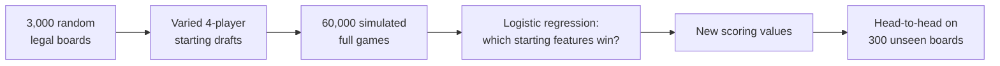

# Does the optimizer pick better starting spots? An analysis

This document explains how the Catan Settlement Optimizer decides where to settle, how its scoring values were measured rather than guessed, and how well its recommendations hold up when tested, including against an independent Catan engine with strong AI players.

The detailed, generated reports behind each section are:

- [`backend/calibration/REPORT.md`](backend/calibration/REPORT.md): fitting the scoring values from 60,000 simulated games
- [`backend/benchmarks/catanatron/BENCHMARK.md`](backend/benchmarks/catanatron/BENCHMARK.md): the Catanatron head-to-head
- [`backend/benchmarks/catanatron/SEAT0.md`](backend/benchmarks/catanatron/SEAT0.md): the follow-up study on placing first

## Summary

| Test | Result |
|---|---|
| Calibrated vs hand-picked scoring values, in our own simulator (300 held-out boards) | **55.8%** vs **52.0%** win rate: **+3.8 points** (95% CI +2.5 to +5.0) |
| A strong AI player (Catanatron's AlphaBeta) using our recommender for its two starting settlements vs choosing them itself (4,800 games) | **28.5%** vs **23.9%** win rate: **+4.6 points** (95% CI +1.4 to +7.8) |
| The same test with the old hand-picked values | 21.0%: −2.9 points, slightly *worse* than the AI's own picks |
| Placing first (seat 0), 800 games per variant | **11.4%** vs **7.9%**: **+3.5 points** (95% CI +0.9 to +6.1) |

In plain terms: in a four-player game, where an even share is 25%, letting the recommender choose the two starting settlements adds about **4–5 wins per 100 games**, roughly a 19% relative improvement. The gain comes from calibrating the scoring values. With the original hand-picked values, the recommender was no better than the AI's own choices.

All results come from simulated play, not human games. See [Limitations](#limitations).

---

## 1. How the recommender scores a spot

For every open intersection, the recommender combines five measurable components. Each is converted to a z-score (how many standard deviations it sits from the average open spot on this board), and the z-scores are added up with weights:

| Component | What it measures | Weight |
|---|---|---|
| Production | Pips on the spot, weighted by what each resource is worth and how rare it is on this board | 39% |
| Your second spot | Monte Carlo estimate of the best second settlement still open on your next turn (first settlement only) | 27% |
| Room to grow | Pips of the best two open spots two roads away | 17% |
| Resource variety | How many different resources the spot produces, weighted by value | 10% |
| Resource pairs | Bonuses for resources that work together (Ore + Wheat, Wood + Brick, …), scaled by how much of the weaker one you produce | 7% |

A port on the spot adds a small extra bonus (9% of the score). For a second settlement there is no "second spot" component, so the remaining weights are rescaled to sum to 100%.

**"Your second spot"** is the only part that needs simulation. The recommender places the candidate settlement, then simulates the opponents who pick before your next turn, thousands of times. Simulated opponents prefer good spots, but not perfectly: each picks a spot with probability proportional to its value raised to a "greediness" power. Their second picks complement their first. The term is the average quality of the best second spot left for you.

The **strategy slider** in the app moves between *raw production* (every resource worth the same, no pair bonuses) and *long game* (the calibrated resource values and bonuses below).

## 2. Measuring the scoring values (calibration)

The weights and resource values started as educated guesses (for example, wheat worth 1.35× and sheep 1.10× an average resource). To replace the guesses with evidence, the project includes a full game simulator and a statistical fitting pipeline in [`backend/calibration/`](backend/calibration/).



### The simulator

**Rules modelled:**
- dice and production (cities produce double), with the robber blocking a hex
- discarding half your cards on a 7 when holding more than 7
- roads, settlements and cities at real costs and piece limits, with road connectivity and the distance rule
- bank and port trades, and simple one-for-one trades between players (never with someone on 8+ points)
- a 25-card development deck: knights with Largest Army, victory-point cards, Road Building, Year of Plenty and Monopoly

Every simulated player uses the **same greedy strategy**: build the best city, settlement, road or dev card you can afford. Because no player is smarter than another, differences in results come from the starting positions. The strategy ranks spots by raw pips only, so it has no built-in opinion about which resources matter.

### The dataset

- **3,000 random boards:** standard resource and number counts, 6s and 8s never adjacent, port types shuffled.
- **Deliberately varied drafts:** four players draft with randomness, so the data covers strong, average and weak starting positions. If everyone picked optimally, every position would look alike and nothing could be learned.
- **20 full games per starting position**, each with different dice.
- **One row per player per board,** recording:
  - wins out of 20 and seat order
  - pips of each resource
  - resource variety and pair strengths
  - expansion potential and port access

### The statistics

- **Model:** binomial generalized linear models, i.e. logistic regression on "wins out of 20 games".
- **Seat order** is included as indicator variables, so going first or last isn't credited to the spot.
- **Cluster-robust standard errors by board,** because the four players on a board compete with each other and their results aren't independent.
- **Resource values** are each resource's coefficient relative to the average resource. Their confidence intervals come from a **bootstrap over boards**: refitting on resampled sets of boards.
- **Fitting is on 80% of boards;** the other 20% are held out for validation.
- **Effects that weren't clearly positive** (p > 0.05) were set to "no bonus" rather than used.

### What the calibration found

| Resource (value per pip, average = 1) | Before (hand-picked) | After (fitted, 95% CI) |
|---|---|---|
| Ore | 1.25 | **1.21** (1.18 – 1.24) |
| Wheat | 1.35 | **1.16** (1.13 – 1.19) |
| Brick | 0.90 | **0.97** (0.94 – 1.00) |
| Wood | 0.90 | **0.91** (0.88 – 0.94) |
| Sheep | 1.10 | **0.75** (0.73 – 0.78) |

- **Pair bonuses:**
  - Ore + Wheat 1.14×, Wood + Brick 1.08×, Wheat + Sheep 1.05×, Wood + Wheat and Brick + Wheat 1.04×
  - Ore + Sheep showed no clear effect, so it gets no bonus
- **Component weights:** production matters most. Room to grow matters more than first assumed (0.19 vs 0.10) and resource pairs less (0.07 vs 0.15).
- **Scarcity:** a resource that's rare on the board is worth up to 52% more.

### Checks along the way

- **The first simulator had no player trading and no progress-card effects.** Under that version, ports looked very valuable and sheep very weak. Adding both features roughly halved the port weight (0.16 → 0.09), which confirms that ports had been inflated because they were the only way to swap cards. Sheep barely moved (0.72 → 0.75), so its low value is genuine: it's only needed for settlements and dev cards, and with four pasture tiles it's rarely the scarce resource.
- **Held-out prediction:** on boards the model never saw, the calibrated score predicts winners better than the hand-picked one (log-loss 0.449 vs 0.460) and ranks a board's four players more accurately (average rank correlation 0.74 vs 0.72).
- **Head-to-head in the simulator:** on the 300 held-out boards, one seat drafts with each set of values while the others use the app's opponent model.

| Starting-spot picker | Win rate |
|---|---|
| **Calibrated values** | **55.8%** |
| Hand-picked values | 52.0% |
| Always take the most pips | 44.5% |
| Random spot | 7.8% |

These win rates are well above 25% because the recommender out-drafts the simulated opponents, which pick less carefully. The comparison that matters is between rows.

## 3. An independent test: Catanatron

Testing a model inside the simulator it was fitted on can flatter it. [Catanatron](https://github.com/bcollazo/catanatron) is an independent, open-source Catan engine whose AlphaBeta search player wins 80% of one-on-one games against its own value-function bot. It shares none of this project's code. The benchmark lives in [`backend/benchmarks/catanatron/`](backend/benchmarks/catanatron/).

**Design:**
- **Four-player games.** The player under test is always an AlphaBeta bot, against three identical AlphaBeta opponents.
- **The arms differ only in how the test player picks its two starting settlements.** Setup roads and the whole rest of the game are identical AlphaBeta play.
  - its own choice (the control)
  - our recommender with calibrated values
  - our recommender with the old hand-picked values
  - most pips
- **Paired seeds:** every arm plays the same 1,200 seeds, so every arm sees the same boards and seats.
- **Translating Catanatron's board into ours:** a translation layer converts Catanatron's board, ports and draft history into this project's board model. Tests verify that all 54 corners map one-to-one, roads and per-corner production are identical, and every port lands on a real coastal edge.

**Results (1,200 games per arm):**

| Who picks the starting settlements | Win rate (95% CI) | vs the AI's own picks (95% CI) |
|---|---|---|
| **Our recommender (calibrated)** | **28.5%** (26.0 – 31.1) | **+4.6** (+1.4 to +7.8) |
| AlphaBeta itself | 23.9% (21.6 – 26.4) | — |
| Our recommender (hand-picked values) | 21.0% (18.8 – 23.4) | −2.9 (−5.8 to +0.1) |
| Most pips | 15.0% (13.1 – 17.1) | −8.9 (−11.8 to −6.0) |

The control won close to its fair 25% share, as it should. The recommender's advantage held up in an engine with much stronger players than ours, and it disappears without the calibration.

## 4. Follow-up: is placing first a weakness?

In the benchmark's breakdown by seat, the recommender looked *worse* than the AI from seat 0 (placing first): 9.4% vs 14.1% on about 320 games. Seat 0 is unusual: six opponent picks happen before its second settlement, and its second settlement is the last pick of the draft. A dedicated study ran 800 paired games per variant with the test player always in seat 0, each variant testing one explanation:

| Variant | Hypothesis tested | Win rate | vs the AI's own picks |
|---|---|---|---|
| AlphaBeta's own picks | control | 7.9% | — |
| **Recommender (current)** | was it noise? | **11.4%** | **+3.5** (CI +0.9 to +6.1) |
| Follow-up term off | the "second spot" weight is too high | 10.8% | +2.9 |
| Follow-up weight halved | same | 11.4% | +3.5 |
| Greedier simulated opponents | the opponent model is too mild | 12.0% | +4.1 (Holm p = 0.038) |
| Recommender for the first pick only | one pick is the problem | 10.3% | +2.4 (not significant) |
| Recommender for the second pick only | same | 11.8% | +3.9 (Holm p = 0.038) |
| Raw production (no resource weighting) | resource weighting costs pips | 8.5% | +0.6 (no effect) |

The p-values are Holm-adjusted for comparing seven variants against the same control.

**Findings:**
- **The original deficit was noise.** Replaying the original 320 seat-0 games, the control won 9.1% instead of 14.1%. With more games, the recommender helps from the first seat too.
- **The resource weighting is the recommender's edge.** Without it, the recommender is no better than the AI. From seat 0 it gives up about 0.8 pips on the first settlement to get more ore and wheat, and that trade wins.
- **The second settlement carries the most value,** and the follow-up weight itself matters little.
- **One real improvement remains.** The "second spot" prediction is optimistic: it expects about 10.7 pips, while the real second spot averages 8.7. Simulating greedier opponents narrows the gap and was the best variant, but only 0.6 points better than the current setting, which is within noise.

## 5. Reading the numbers

- **More games don't raise the win rate.** They narrow the uncertainty around it. With 10,000 games the +4.6-point estimate would be about ±1 point instead of ±3.
- **Why not higher?** The recommender only chooses two settlements. Dice, the robber, trades and the rest of the game are played identically by every player, so no setup choice can make a player win most games against equally strong opponents. A gain of a few points from setup alone is a meaningful edge.
- **The app's "Simulations" setting** controls how many Monte Carlo runs the recommender uses per recommendation. More runs give a steadier "second spot" estimate but barely change the picks: the benchmark used 1,000 runs per pick.

## Limitations

- **All results are simulated play, not human games.** In this project's simulator every player follows one greedy strategy; Catanatron's bots are stronger but still bots.
- **Rules not modelled:**
  - **This project's simulator:** Longest Road, negotiated or multi-card trades, and the bank running out of cards. Its player trades are one-for-one only.
  - **Catanatron:** its bots don't trade with each other.
- **The opponents are uniform.** All Catanatron opponents were the same AlphaBeta bot, so results against humans or mixed opponents may differ.
- **Catanatron games aren't fully reproducible:** 82–86% of replayed seeds gave the same winner. The likely cause is Python's per-process hash randomization changing how bots order tied moves. Comparisons remain unbiased and the confidence intervals reflect the real variation, but the pairing between arms is less tight than designed.
- **The "second spot" estimate is optimistic** (see section 4).

## Reproducing the analysis

From `backend/`:

```bash
uv run --group calibration python -m calibration.run
```

```bash
uv run --group benchmark --group calibration python -m benchmarks.catanatron.run
```

```bash
uv run --group benchmark --group calibration python -m benchmarks.catanatron.seat0
```

| Run | What it does | Time (10 cores) |
|---|---|---|
| Calibration | Simulate, fit, head-to-head, write `REPORT.md` | ~5 minutes |
| Catanatron benchmark | 4,800 paired games, write `BENCHMARK.md` | ~20 minutes |
| Seat-0 study | 6,400 paired games, write `SEAT0.md` | ~28 minutes |

Each command accepts `--quick` for a one- or two-minute smoke run. Calibration never changes the app's values by itself; applying new values is a reviewed change to `backend/scorer.py`.
